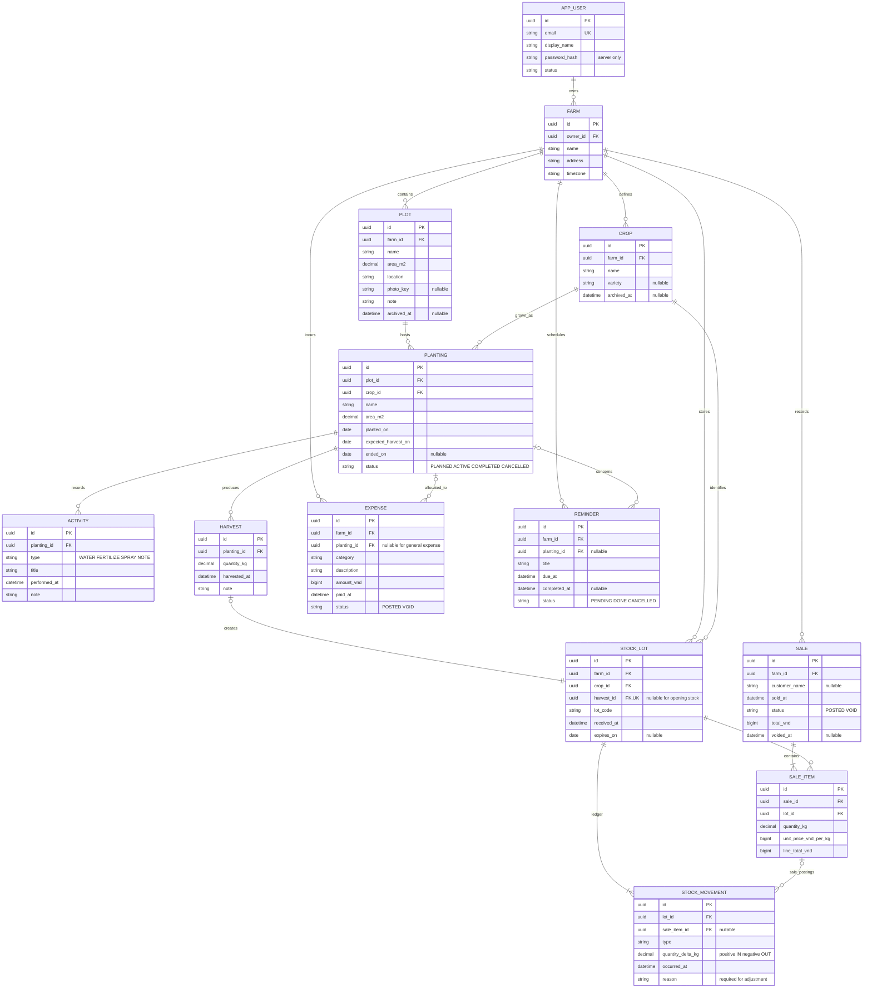
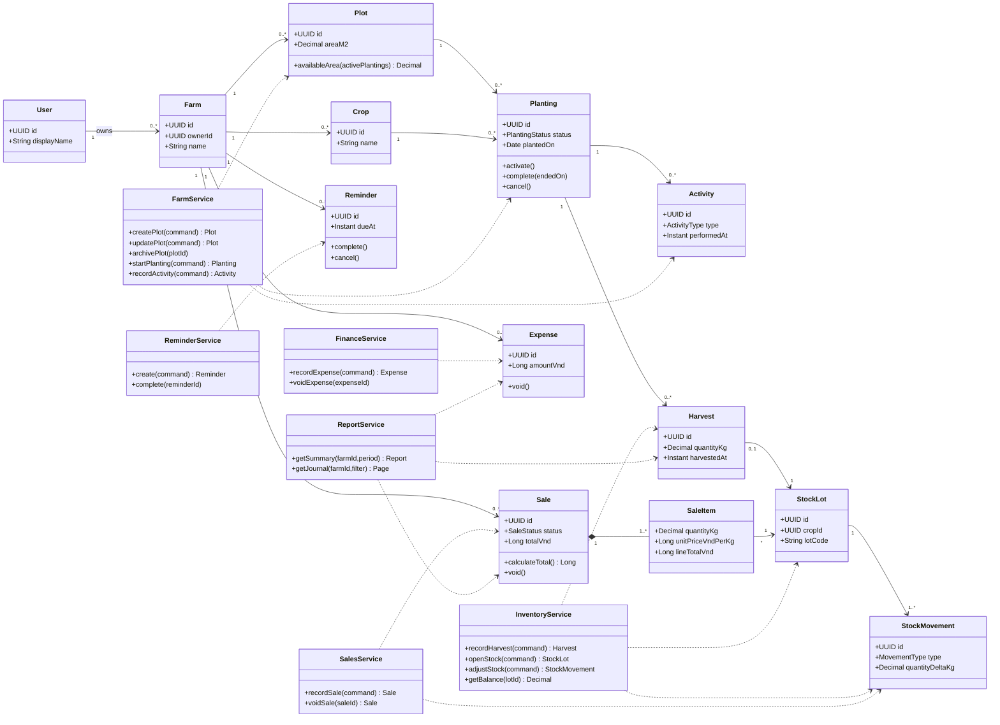

# Thiết kế database và API — Nông Sản Xanh

> **Thiết kế đề xuất, chưa phải database/API đã triển khai.** Dựa trên các màn hình và nghiệp vụ hiện có. Chỉ thêm tài liệu thiết kế; chưa thay đổi mã chạy của app.

## 1. Phạm vi và quy ước

- Phiên bản đầu: một tài khoản sở hữu nhiều nông trại; mỗi nông trại có nhiều thửa đất. Chưa có chia sẻ nông trại cho nhiều thành viên.
- Giao diện có thể tạo mặc định một nông trại để người dùng bắt đầu nhanh.
- Thửa đất = **Plot**; nông trại = **Farm**; loại cây = **Crop**; vụ trồng = **Planting**.
- Một vụ trồng thuộc một thửa đất và một loại cây. Trồng xen nhiều loại cây được biểu diễn bằng nhiều vụ đang hoạt động trên các phần diện tích khác nhau. Chưa hỗ trợ tính diện tích chồng lấn.
- Kho theo **lô nông sản**; màn hình kho tổng hợp các lô theo loại cây.
- Khối lượng: kg, tối đa 3 chữ số thập phân. Diện tích: m², tối đa 2 chữ số thập phân. Tiền: đồng Việt Nam nguyên.
- Giai đoạn đầu: bán hàng thu tiền ngay; chưa có công nợ, trả góp, thuế và chiết khấu. Các chức năng đó cần mở rộng mô hình.
- ERD dùng kiểu dữ liệu logic để có thể chuyển sang Room hoặc database máy chủ; không phải DDL chạy trực tiếp.

## 2. ERD đầy đủ

PK = khóa chính; FK = khóa ngoại; UK = duy nhất. Các trường nullable được chú thích ngay trong sơ đồ.



### Vai trò của 13 bảng

| Bảng | Vai trò |
|---|---|
| APP_USER | Tài khoản người dùng trên máy chủ |
| FARM | Nông trại và chủ sở hữu |
| PLOT | Thửa đất, diện tích, vị trí, ảnh và ghi chú |
| CROP | Danh mục loại cây theo nông trại |
| PLANTING | Vụ trồng cụ thể, diện tích và vòng đời |
| ACTIVITY | Chăm sóc: tưới, bón phân, phun thuốc, ghi chú |
| HARVEST | Từng đợt thu hoạch của một vụ |
| STOCK_LOT | Lô hàng có thể truy về lần thu hoạch; hoặc tồn đầu kỳ |
| STOCK_MOVEMENT | Sổ nhập/xuất/điều chỉnh của từng lô |
| SALE | Phiếu bán đã ghi nhận hoặc đã hủy |
| SALE_ITEM | Dòng bán từ một lô hàng cụ thể |
| EXPENSE | Khoản chi cho một vụ hoặc cho toàn nông trại |
| REMINDER | Việc cần làm, hạn và trạng thái hoàn thành |

### Những trường chung được lược bỏ trên sơ đồ

Các bảng có `created_at`, `updated_at`, `version` để theo dõi thay đổi. Khi có API, bản ghi nghiệp vụ có `created_by` tham chiếu người dùng đã tạo.

- `version`: số nguyên, tăng khi cập nhật; dùng kiểm soát việc hai thiết bị sửa cùng bản ghi.
- `created_at/updated_at`: thời điểm UTC; máy chủ quyết định giá trị chính thức.
- `*_on`: ngày lịch ISO 8601, ví dụ `2026-09-26`.
- `*_at`: thời điểm ISO 8601 có múi giờ, ví dụ `2026-09-26T01:00:00Z`.
- `FARM.timezone`: mặc định `Asia/Bangkok`; dùng chia ngày/tháng trong báo cáo và lịch nhắc.
- Bản ghi xuất/nhập đã ghi sổ không bị sửa hoặc xóa trực tiếp. Sai số được sửa bằng giao dịch bù.
- Khi bổ sung đồng bộ và xóa mềm, thêm tombstone/`deleted_at` cho các loại bản ghi được phép xóa. Không áp dụng xóa mềm để làm biến mất lịch sử kho hoặc bán hàng.

### Kiểu dữ liệu khi triển khai

| Giá trị | Database máy chủ | Room/SQLite | API JSON |
|---|---|---|---|
| ID | UUID | TEXT | Chuỗi UUID |
| Diện tích | NUMERIC(12,2) | Long, số đơn vị 0,01 m² | Chuỗi thập phân: `"600.00"` |
| Khối lượng | NUMERIC(14,3) | Long, số gram | Chuỗi thập phân: `"12.500"` |
| Số tiền VND | BIGINT | Long | Chuỗi số nguyên: `"250000"` |
| Thời điểm | Timestamp có múi giờ | Long epoch milliseconds | Chuỗi ISO 8601 |
| Ngày lịch | DATE | TEXT ISO date | `"2026-09-26"` |

Không dùng Float/Double cho tiền và số lượng lưu trữ. Phép nhân tiền cần kiểm tra giới hạn Long; tính bằng số thập phân chính xác. Giới hạn dữ liệu đầu vào phải thống nhất trên app và máy chủ.

`password_hash` chỉ tồn tại phía máy chủ, không tải về Room và không trả trong API. Nếu dùng nhà cung cấp xác thực thì thay bằng liên kết danh tính của nhà cung cấp; không tự lưu mật khẩu.

## 3. Ràng buộc cần triển khai

### Quyền sở hữu và liên kết

1. Mọi truy vấn API phải kiểm tra người dùng có sở hữu nông trại tương ứng hay không.
2. `PLANTING.plot_id` và `crop_id` phải thuộc cùng nông trại.
3. Nông trại và loại cây của `STOCK_LOT` phải khớp vụ trồng của `HARVEST`, nếu có.
4. Mọi lô hàng trong một phiếu bán phải thuộc nông trại của phiếu đó.
5. `EXPENSE.planting_id` và `REMINDER.planting_id`, nếu có, phải thuộc `farm_id` của bản ghi.
6. FK đơn lẻ không bảo đảm các quy tắc liên bảng này. Service phải xác minh trong giao dịch; khi xây DDL máy chủ có thể bổ sung composite FK hoặc trigger tương ứng.

### Thửa đất và vụ trồng

- Diện tích thửa đất và vụ trồng phải lớn hơn 0.
- Tổng diện tích các vụ ACTIVE trên cùng thửa đất không vượt diện tích thửa đất.
- Kiểm tra lại diện tích khi kích hoạt vụ PLANNED; khóa bản ghi thửa đất trong giao dịch để ngăn hai yêu cầu cùng chiếm phần đất còn trống.
- Ngày thu hoạch dự kiến và ngày kết thúc không được trước ngày trồng.
- PLANNED → ACTIVE → COMPLETED; có thể CANCELLED theo điều kiện nghiệp vụ. Không hủy một vụ đã có thu hoạch; kết thúc vụ để giữ lịch sử.
- Thửa đất đang có vụ ACTIVE phải kết thúc vụ trước khi lưu trữ.
- Chưa có vụ/nhật ký phụ thuộc: có thể xóa thửa đất. Đã phát sinh lịch sử: dùng lưu trữ, FK chặn xóa dây chuyền.
- Trạng thái “đang trồng/để trống” của thửa đất được tính từ các vụ ACTIVE, không lưu thêm một cờ độc lập.

### Kho và bán hàng

- Số lượng thu hoạch và bán phải lớn hơn 0; tồn mỗi lô không được âm.
- Một HARVEST tạo đúng một STOCK_LOT trong phiên bản đầu; `harvest_id` duy nhất khi khác NULL.
- `UNIQUE(farm_id, lot_code)`.
- STOCK_MOVEMENT có các loại:
  - HARVEST_IN, OPENING_IN, SALE_VOID_IN, ADJUST_IN: delta dương.
  - SALE_OUT, ADJUST_OUT: delta âm.
- Mỗi lô có đúng một giao dịch tạo tồn ban đầu: HARVEST_IN nếu có harvest_id, ngược lại OPENING_IN. Không được có đồng thời hai loại.
- Với SALE_OUT và SALE_VOID_IN: bắt buộc sale_item_id. Với các loại còn lại: sale_item_id phải NULL.
- `UNIQUE(sale_item_id, type)` khi sale_item_id khác NULL: mỗi dòng bán chỉ xuất một lần và hoàn kho do hủy tối đa một lần.
- Delta SALE_OUT = âm số lượng dòng bán. Delta SALE_VOID_IN = dương số lượng dòng bán.
- ADJUST_IN/OUT bắt buộc lý do.
- Tồn lô = tổng `quantity_delta_kg`. Nếu bổ sung cột tồn để tăng tốc, đó là số tổng hợp phải cập nhật cùng giao dịch và có kiểm tra đối chiếu.
- Bán/hủy/điều chỉnh phải khóa các lô liên quan theo cùng thứ tự ID; mọi đường ghi kho phải tuân thủ quy tắc này. Room dùng giao dịch ghi; cơ chế khóa máy chủ được triển khai theo database đã chọn.
- `line_total_vnd = roundHalfUp(quantity_kg × unit_price_vnd_per_kg)`; total_vnd = tổng line_total_vnd. Máy chủ tính, không tin tổng do client gửi.
- Đơn giá dương; phiếu POSTED có ít nhất một dòng. Không cho sửa nội dung phiếu đã POSTED; muốn sửa thì hủy có hoàn kho rồi tạo phiếu mới.
- HARVEST không được sửa/xóa trực tiếp sau ghi sổ. Điều chỉnh kho có lý do chỉ sửa tồn, không tự sửa số liệu thu hoạch lịch sử. Quy trình sửa chứng từ thu hoạch là phần mở rộng sau.

### Chi phí và nhắc việc

- Chi phí > 0; VOID được loại khỏi báo cáo.
- Chi phí có planting_id là chi trực tiếp cho vụ; không có là chi chung của nông trại. Chưa tự chia chi phí chung cho các vụ.
- Reminder DONE phải có completed_at; khi trở về PENDING phải xóa completed_at.
- Gửi/lên lịch thông báo sau khi dữ liệu đã lưu thành công; không gọi hệ thống thông báo ở giữa giao dịch database.
- Chưa có bảng BACKUP nghiệp vụ. Tệp sao lưu có manifest, phiên bản schema và danh sách tệp ảnh. Lịch sử sao lưu có thể thêm riêng sau.

### Chỉ mục nên tạo

- PLOT(farm_id, archived_at)
- CROP(farm_id, archived_at)
- PLANTING(plot_id, status), PLANTING(crop_id)
- ACTIVITY(planting_id, performed_at)
- HARVEST(planting_id, harvested_at)
- STOCK_LOT(farm_id, crop_id), UNIQUE STOCK_LOT(harvest_id) khi khác NULL
- STOCK_MOVEMENT(lot_id, occurred_at)
- SALE(farm_id, sold_at, status), SALE_ITEM(sale_id), SALE_ITEM(lot_id)
- EXPENSE(farm_id, paid_at, status), EXPENSE(planting_id)
- REMINDER(farm_id, status, due_at), REMINDER(planting_id)

## 4. Class diagram

Các class dữ liệu biểu diễn nghiệp vụ; Service điều phối kiểm tra, quyền truy cập và giao dịch. Phương thức trên entity chỉ đổi/kiểm tra trạng thái của entity, không tự gọi API hoặc database. Các liên kết phụ đã có trong ERD được lược bỏ ở đây để giảm đường giao nhau.



### Tách các lớp khi triển khai

**Android dùng ngoại tuyến:**

```text
Compose → ViewModel → UseCase/Service → Repository interface → Room DAO
```

**Khi có máy chủ:**

```text
Android Repository → API client
                         ↓
Controller → Application Service → Repository → Database
                         ↓
                Transaction / Authorization
```

Controller nhận DTO, kiểm tra định dạng và trả HTTP. Service kiểm tra nghiệp vụ và sở hữu giao dịch. Repository thực hiện đọc/ghi, không mở màn hình hoặc gửi thông báo. Với thao tác bán hàng/thu hoạch, nhiều repository phải dùng chung một giao dịch; không commit độc lập từng bảng.

Class diagram chưa khóa lựa chọn Spring Boot, Ktor hoặc công nghệ máy chủ khác. ViewModel thuộc Android và không dùng lại làm controller máy chủ.

## 5. Thiết kế API đề xuất

Base path: `/api/v1`. Các endpoint dưới đây cần xác thực, ngoại trừ đăng ký/đăng nhập. Khi app chỉ dùng Room, triển khai cùng nghiệp vụ qua repository mà chưa cần API.

| Nhóm | Method và endpoint | Xử lý |
|---|---|---|
| Tài khoản | POST /auth/register, /auth/login, /auth/refresh, /auth/logout | Xác thực phía máy chủ |
| Hồ sơ | GET /me; PATCH /me | Xem/sửa hồ sơ |
| Nông trại | GET /farms; POST /farms | Danh sách/tạo nông trại |
| Thửa đất | GET /farms/{farmId}/plots; POST cùng đường dẫn | Lọc và tạo thửa đất |
| Chi tiết đất | GET /plots/{id}; PATCH /plots/{id} | Xem/sửa thông tin |
| Xóa/lưu trữ đất | DELETE /plots/{id}; POST /plots/{id}/archive | Chỉ xóa nếu chưa có lịch sử |
| Loại cây | GET /farms/{farmId}/crops; POST cùng đường dẫn | Danh mục cây |
| Vụ trồng | GET /plots/{plotId}/plantings; POST cùng đường dẫn | Danh sách/tạo vụ |
| Chi tiết vụ | GET /plantings/{id}; PATCH /plantings/{id} | Sửa thông tin theo trạng thái |
| Vòng đời vụ | POST /plantings/{id}/activate, /complete, /cancel | Kiểm tra diện tích/trạng thái |
| Chăm sóc | GET /plantings/{id}/activities; POST cùng đường dẫn | Tưới/bón/phun/ghi chú |
| Thu hoạch | GET /plantings/{id}/harvests; POST cùng đường dẫn | Ghi thu hoạch + tạo lô + nhập kho |
| Tổng kho | GET /farms/{farmId}/inventory | Tổng hợp tồn theo loại cây |
| Các lô | GET /farms/{farmId}/stock-lots?cropId=... | Các lô và tồn từng lô |
| Tồn đầu kỳ | POST /farms/{farmId}/stock-lots/opening | Tạo lô tồn ban đầu |
| Điều chỉnh kho | POST /stock-lots/{id}/adjustments | Ghi delta và lý do |
| Lịch sử kho | GET /stock-lots/{id}/movements | Sổ nhập/xuất |
| Bán hàng | GET /farms/{farmId}/sales; POST cùng đường dẫn | Danh sách/tạo phiếu bán |
| Chi tiết/hủy bán | GET /sales/{id}; POST /sales/{id}/void | Hủy phiếu và hoàn kho |
| Chi phí | GET /farms/{farmId}/expenses; POST cùng đường dẫn | Ghi chi chung/chi theo vụ |
| Hủy chi | POST /expenses/{id}/void | Giữ lịch sử chứng từ |
| Nhắc việc | GET /farms/{farmId}/reminders; POST cùng đường dẫn | Tạo và lọc công việc |
| Sửa nhắc việc | PATCH /reminders/{id} | Nội dung, hạn, trạng thái |
| Nhật ký tổng hợp | GET /farms/{farmId}/journal | Hợp nhất chăm sóc, thu hoạch, bán và chi |
| Báo cáo | GET /farms/{farmId}/reports/summary?from=...&to=... | Sản lượng/doanh thu/chi phí/tồn |
| Xuất dữ liệu | GET /farms/{farmId}/exports/journal?format=csv | File xuất từ dữ liệu được cấp quyền |

### Nhật ký và báo cáo không cần bảng riêng ở phiên bản đầu

- ACTIVITY chỉ chứa các hoạt động chăm sóc; không sao chép thu hoạch/bán/chi vào ACTIVITY.
- API journal hợp nhất ACTIVITY, HARVEST, SALE và EXPENSE theo thời điểm; mỗi dòng có `sourceType`, `sourceId`.
- Sản lượng = SUM HARVEST.quantity_kg trong kỳ.
- Doanh thu = SUM SALE.total_vnd có status POSTED trong kỳ.
- Chi phí = SUM EXPENSE.amount_vnd có status POSTED trong kỳ.
- Chênh lệch thu–chi = doanh thu − chi phí. Không gọi đây là lợi nhuận kế toán vì chưa tính giá vốn, tồn kho và phân bổ chi phí.
- Tồn kho hiện tại = tổng các movement; tồn tại thời điểm T = tổng movement có occurred_at <= T.
- Bản đầu chưa cung cấp doanh thu phân bổ cho từng vụ từ phiếu nhiều dòng; nếu cần, lấy doanh thu theo SALE_ITEM → STOCK_LOT → HARVEST → PLANTING.
- Nếu hủy một phiếu bán ở kỳ cũ, báo cáo kỳ cũ sẽ đổi theo status VOID. Báo cáo kế toán bất biến theo kỳ cần chứng từ đảo và quy trình khóa kỳ riêng.

### Ví dụ ghi thu hoạch

```http
POST /api/v1/plantings/{plantingId}/harvests
Idempotency-Key: <UUID duy nhất cho thao tác>
Content-Type: application/json
```

```json
{
  "id": "<harvest UUID>",
  "quantityKg": "50.000",
  "harvestedAt": "2026-09-26T01:00:00Z",
  "note": "Thu hoạch buổi sáng"
}
```

Một giao dịch:
1. Xác thực quyền sở hữu và vụ ACTIVE, thời điểm thu hoạch hợp lệ.
2. Tạo HARVEST.
3. Tạo STOCK_LOT với harvest_id tương ứng.
4. Tạo STOCK_MOVEMENT loại HARVEST_IN, delta +50 kg.
5. Ghi kết quả idempotency và commit tất cả; bất kỳ bước nào lỗi thì rollback.

Trả 201 với harvestId, lotId, movementId và tồn lô mới. Gửi lại cùng khóa và cùng nội dung trả lại kết quả cũ.

### Ví dụ bán hàng

```http
POST /api/v1/farms/{farmId}/sales
Idempotency-Key: <UUID duy nhất cho thao tác>
Content-Type: application/json
```

```json
{
  "id": "<sale UUID>",
  "customerName": "Thương lái A",
  "soldAt": "2026-09-26T03:00:00Z",
  "items": [
    {
      "lotId": "<lot UUID>",
      "quantityKg": "12.500",
      "unitPriceVndPerKg": "18000"
    }
  ]
}
```

Một giao dịch: khóa lô → tính lại tồn → kiểm tra số lượng → tạo phiếu và dòng bán → tạo SALE_OUT → lưu kết quả idempotency → commit. Dòng bán ví dụ có thành tiền 225.000 đồng.

Phiên bản đầu yêu cầu lotId cụ thể. Nếu muốn bán theo tên nông sản và tự chọn lô, phải thêm quy tắc FIFO/FEFO rõ ràng; không chọn tùy ý.

### Hợp đồng chung

- Phân trang bằng cursor; `limit` mặc định 20, tối đa 100; sắp xếp ổn định bằng thời điểm + ID.
- Dữ liệu ngày tháng trên form dd/MM/yyyy phải chuyển sang ISO trước khi gửi API.
- PATCH gửi version hiện tại; trả 409 nếu version đã thay đổi.
- Các thao tác làm thay đổi kho/tài chính cần Idempotency-Key và body hash. Cùng khóa khác nội dung trả 409.
- Máy chủ cần bảng kỹ thuật `IDEMPOTENCY_REQUEST`: user_id, scope, key, request_hash, response_status, response_body, created_at, expires_at; unique(user_id, scope, key). Ghi kết quả trong cùng giao dịch nghiệp vụ, tránh hai request cùng xử lý. Bảng này không nằm trong 13 bảng nghiệp vụ trên ERD.
- Dùng ID do client sinh cho các lệnh tạo từ thiết bị ngoại tuyến; có unique PK để không tạo lại sau khi khóa idempotency hết hạn.
- 400: JSON/định dạng sai; 401: chưa đăng nhập; 403: thiếu quyền; 404: không tìm thấy trong phạm vi truy cập; 409: thiếu tồn, xung đột phiên bản hoặc trạng thái; 422: dữ liệu vi phạm nghiệp vụ.
- Lỗi trả dạng: `{"code":"INSUFFICIENT_STOCK","message":"Lô hàng chỉ còn 10 kg","field":"items[0].quantityKg"}`.
- Không trả password_hash hoặc thông tin nông trại khác trong phản hồi.
- Ảnh trên máy chủ lưu ở kho tệp, database chỉ giữ photo_key. URI ảnh Android chỉ có ý nghĩa trên thiết bị; không dùng làm URL ảnh máy chủ.
- Nếu thêm offline sync: cần bảng hàng đợi lệnh cục bộ (outbox), trạng thái pending/synced/failed và quy tắc xử lý xung đột. Không xem việc có UUID/version là đã triển khai đồng bộ. Hai thiết bị offline cùng bán một lô có thể bị máy chủ từ chối một phiếu khi đồng bộ.

## 6. Ánh xạ từ mã hiện tại

| Hiện tại | Thiết kế mới |
|---|---|
| domain.Farm đang có name/areaNote | Tách Farm (nông trại) và Plot (thửa đất); dữ liệu đang đại diện thửa đất chuyển sang Plot |
| ui.Land | Plot; chuyển crop/cropAreas/ngày trồng sang Planting |
| ui.Product(name, quantity) | Crop + StockLot + StockMovement; quantity là số tổng hợp |
| ui.FarmLog | Activity/Harvest/Sale/Expense theo từng loại; nhật ký là truy vấn hợp nhất |
| ui.Reminder.land là tên | Dùng farmId và plantingId; tên chỉ để hiển thị |
| FarmState + SharedPreferences | Room entities/DAO + repository + ViewModel |
| ReportScreen số liệu mẫu | ReportService truy vấn dữ liệu thật |
| Sao lưu JSON giao diện | Sao lưu có schema version và tệp ảnh, triển khai sau dữ liệu nền |

Không liên kết nghiệp vụ bằng tên thửa đất hoặc tên cây: tên có thể trùng hoặc đổi. Không giữ một cột crop dạng chuỗi ghép nhiều tên cây.

## 7. Thứ tự triển khai

1. Farm + Plot + Room + repository + ViewModel; hoàn thiện luồng quản lý thửa đất.
2. Crop + Planting + kiểm tra diện tích và ngày; giữ lịch sử nhiều vụ.
3. Activity + Reminder.
4. Harvest + StockLot + StockMovement; kiểm thử tính tồn và giao dịch.
5. Sale + SaleItem + Expense; kiểm thử bán quá tồn, gửi lại request và hủy hoàn kho.
6. Báo cáo, sao lưu và xuất dữ liệu.
7. Khi cần máy chủ: tài khoản, API, quyền sở hữu, idempotency rồi đồng bộ ngoại tuyến.

### Các kiểm thử nghiệp vụ nên có

- Hai yêu cầu kích hoạt vụ không làm tổng diện tích vượt thửa đất.
- Gửi lại ghi thu hoạch không tăng kho lần hai.
- Hai yêu cầu bán đồng thời không làm tồn âm.
- Phiếu có nhiều lô: một lô thiếu hàng thì rollback toàn phiếu.
- Hủy phiếu nhiều lần chỉ hoàn kho một lần.
- Không thể bán lô của nông trại khác hoặc dùng plantingId của chủ khác.
- Đổi tên thửa đất/cây không làm mất liên kết nhật ký.
- Thu hoạch nhiều đợt và bán từng phần vẫn đối chiếu được tồn theo lô.

